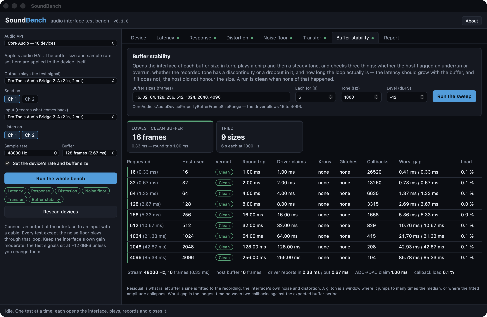

# SoundBench user guide

SoundBench measures an audio interface: it plays test signals out of one of the interface's
outputs, records them through one of its inputs, and reports what happened on the way round:
how long it took, the frequency response and distortion, how quiet the input is, and which
buffer sizes it runs cleanly at.

Alongside every measurement it shows what the driver *claims*, because the difference is often
what you came to find out.

*The Buffer stability tab after a full run against Pro Tools Audio Bridge, a virtual CoreAudio loopback rather than a hardware interface, which is why every size comes back clean and the round trip is exactly three buffers. Nine sizes from 16 to 4096 frames, each checked for xruns, for glitches in the recorded tone, and for the latency the driver claims against the one measured.*

## Before you start

**Make a loop.** Connect an output of the interface to an input with a cable. Analogue is what
you want, since the idea is to measure the converters, but a digital loop (S/PDIF out to in, or a
virtual loopback device) works too and tells you about the driver on its own.

**Set the gain.** The test signals sit at −12 dBFS, except the distortion tone at −1 dBFS. Set
the interface's input gain so a −1 dBFS tone comes back near −1 dBFS without the input stage
clipping. If the interface has a line/instrument switch on that input, use line.

**Close the DAW.** ASIO drivers are exclusive. CoreAudio devices can be shared, but the device's
sample rate and buffer size will change while SoundBench runs a test, and a DAW using the same
device will hear it.

## The setup column

- **Audio API.** CoreAudio on a Mac. On Windows: WASAPI, WDM-KS, DirectSound, MME, and ASIO if
  the build includes it. Each is a different route to the same hardware, and a device measures
  differently through each. WASAPI shared mode in particular goes through the Windows mixer at
  its own 10 ms period.
- **Output / Input.** The devices, usually the same one. **Send on** picks the output channel
  that carries the signal, and **Listen on** picks the input channels to record. You can listen
  on more than one input at once, and each gets its own results, so a stereo loop measures both
  sides in one go.
- **Sample rate.** Only the rates the driver accepts are offered.
- **Buffer.** Frames per callback. On CoreAudio and ASIO this is applied to the device, and in
  WASAPI exclusive mode it sizes the period. The candidates come from the driver where it
  publishes a range (CoreAudio, ASIO) and are powers of two elsewhere.
- **Set the device's rate and buffer size** (macOS). When it's on, SoundBench sets the device's
  own nominal rate and buffer frame size for the test and refuses to resample. When it's off,
  PortAudio converts, and the buffer size only applies to its own buffering.
- **Exclusive mode** (WASAPI). On by default, so you're measuring the device and not the mixer.

**Run the whole bench** runs every test in turn. Results stay until the device, the channels or
the sample rate change.

## Device

Everything the driver has to say for itself. From PortAudio you get channels, default rate, the
rates it accepts, the buffer range, and the latency it declares. On macOS the HAL's own
properties follow: transport (USB, Thunderbolt, built-in, virtual, aggregate), device and model
UIDs, the manufacturer, the nominal rate and the list of available ones, the buffer size the
device is on right now and its range, the declared latency and *safety offset* per direction,
the physical stream format (the bit depth the hardware is actually running, and whether it's
integer or float), whether another process has the device open, and whether anyone holds it in
hog mode.

## Latency

Five short chirps are played at known positions and found again in the recording by
cross-correlation. The distance between where a chirp was written and where it came back is the
**round trip**: output buffers, DAC, cable, ADC, input buffers, in samples of the stream's own
clock. There's nothing to calibrate.

- **Measured round trip:** the number a DAW needs to compensate.
- **Driver reports:** PortAudio's input plus output latency for the stream.
- **Unreported:** measured minus reported. Positive means the interface has latency the driver
  doesn't declare, and a DAW compensating from the driver's figure would place recorded audio
  early by this much.
- **Stability:** the spread between the five bursts. More than a sample means the loop's delay
  is moving.
- **Polarity:** whether the signal came back inverted.

Raise **Listen up to** for network audio or virtual devices whose loop is longer than a second.

## Response

One exponential sine sweep (10 Hz to 22 kHz over ten seconds by default), deconvolved with its
inverse filter. The linear part of the loop becomes an impulse response, and each order of
harmonic distortion becomes its own smaller impulse response arriving a fixed time before it. So
from one sweep you get the **magnitude** response, the **phase** (with the round-trip delay
removed, so what's left is the converters' filters), the **harmonic distortion against
frequency** (THD, and the second and third harmonics separately), and the **impulse response**
itself.

Everything is relative to the same sweep through a perfect wire, so 0 dB is unity and a
bit-exact loop reads flat. The distortion curve is blank in the first octave above the sweep's
start and wherever a harmonic would fall above the sweep's top.

The readings table gives the numbers at standard frequencies for a report.

## Distortion

One steady tone (997 Hz at −1 dBFS by default, as AES17 specifies) and one long FFT.

- **THD+N:** everything in the 20 Hz–20 kHz band that isn't the fundamental, against the
  fundamental. The headline distortion figure.
- **THD:** the harmonics alone.
- **SNR** and **SINAD**.
- **Level received:** against the level sent, giving the loop gain.
- **Frequency:** the received tone's frequency against the generated one, in ppm. Through one
  interface this is near zero, and through two devices on separate clocks it's their difference.
- **DC offset**.
- The harmonics H2–H9 individually, and the spectrum.

The band is capped at 20 kHz whatever the sample rate, so a device measured at 96 kHz gets the
same figure as at 48 kHz rather than being marked down for the extra octave of noise.

## Noise floor

Digital silence goes out, and the input is recorded with the stream running. It's reported
unweighted in the 20 Hz–20 kHz band (0 dBFS minus this is the dynamic range a spec sheet quotes),
A-weighted, over the full bandwidth, and as a peak. Narrow peaks standing more than 12 dB above
the surrounding floor are listed by frequency: mains hum and its harmonics, USB packet whine
(1 kHz, 8 kHz) and switch-mode supplies.

## Transfer

This is the cross-check on the sweep, with a different stimulus (pink or white noise) and a
different estimator (Welch-averaged cross-spectra). It adds **coherence**, which is 1 where the
output is a linear function of the input and lower wherever noise or distortion dominates. Where
coherence is high the sweep and this should agree. Where it drops, believe neither of them.

## Buffer stability

The interface is opened at each buffer size in the list, a chirp and then a steady tone are
played through the loop, and it's closed again. For each size:

- **Host used:** the buffer the host actually reports (CoreAudio's device buffer size, WASAPI's
  host buffer), or the frames per callback where the host can't say.
- **Round trip:** measured from the chirp. It should grow with the buffer, and if it doesn't, the
  host didn't honour the size.
- **Driver claims:** the reported latency at that size.
- **Xruns:** underruns and overruns the host flagged.
- **Glitches:** discontinuities (the tone's phase or level jumped) and dropouts (the tone
  vanished) found in the recording, with when and for how long.
- **Callbacks:** how many, and how many arrived late (more than 1.5× the expected period after
  the previous one). **Worst gap** is the longest interval against the expected one.

**Clean** means none of that happened. **Xruns, audio intact** means the host flagged a problem
but the recording shows none. **Glitches** means the recording does. **Would not open** means the
driver refused the size. **No signal back** means it opened but the loop was silent, which is
usually a size the interface will happily accept and then can't actually clock.

The lowest clean buffer, and its round trip, is the number to set the DAW to.

## Report

Everything measured on the current setup, as Markdown to read and JSON to keep. The JSON carries
every curve and every burst, and the Markdown is the summary with the readings tables.

## What the numbers do not tell you

- Everything is measured through the loop: output *and* input, converter *and* converter. A
  response or distortion figure belongs to the pair, not to one side.
- The latency is the loop's under this host API at this buffer size. Change either and measure
  again.
- A virtual or digital loop measures the driver, not the converters, and reads perfect.
- Nothing here measures levels in volts, only in dBFS. An interface's headroom, output level and
  input sensitivity need a meter.
